## Daniiel Gallegos NC 1392
| 🚨 Problema | 📝 Descripción | 💡 Ejemplo |
| :--- | :--- | :--- |
| **Datos nulos** | Información que no está registrada o es desconocida. | El campo "Edad" está vacío. |
| **Duplicados** | Registros idénticos repetidos, lo que sesga el modelo. | Dos filas con el mismo ID y datos. |
| **Tipos incorrectos** | Datos almacenados con un formato inadecuado. | La edad guardada como texto `"25"` en lugar de número `25`. |
| **Valores atípicos** | Valores extremos que se alejan del comportamiento habitual. | Una edad registrada como `250` años. |
## Titanic

## 1. Cargar el archivo CSV
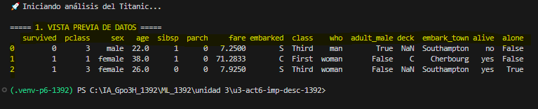
## 2. Conocer las dimensiones
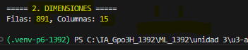
## 3. Revisar los tipos de datos
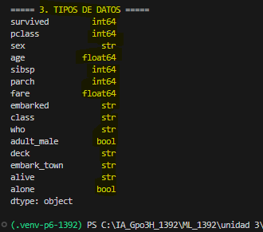
## 4. Identificar y contar datos nulos
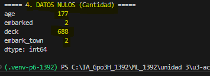
## 5. Calcular porcentaje de datos nulos
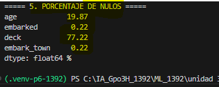
## 6. Identificar registros duplicados
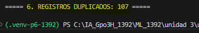
## 7. Detección de Valores Atípicos (Outliers) en la Edad usando IQR
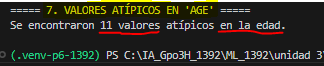
## 8. Visualización de datos nulos (Heatmap)
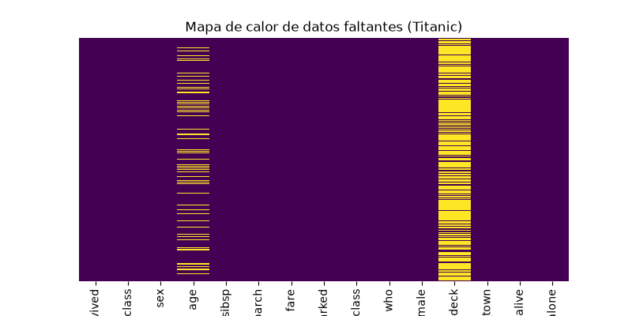
## 9. Limpieza básica (Copia para no alterar el original)
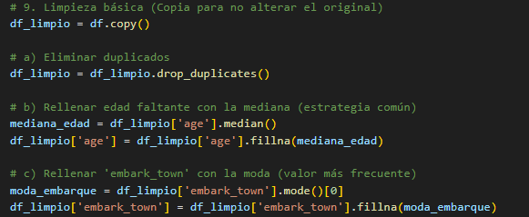
## 10. Guardar el dataset limpio
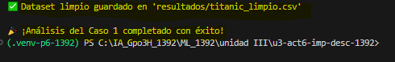
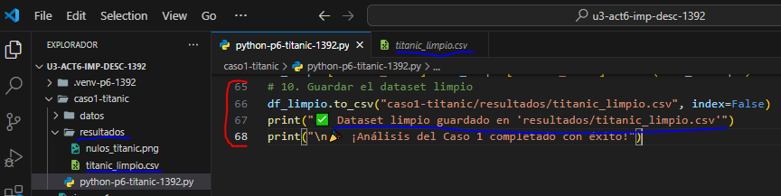